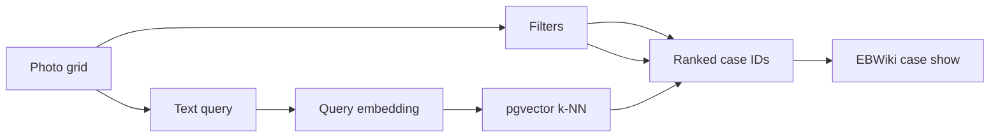
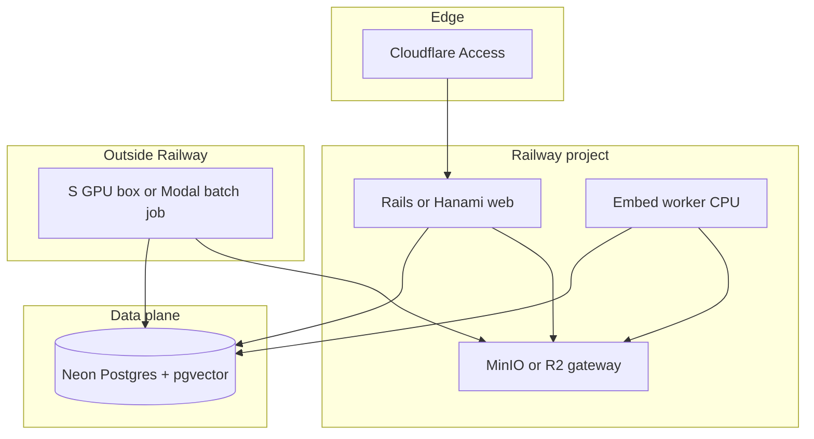

# Photo-first search for EBWiki (private, self-hosted)

Linear: [GKT-1338](https://linear.app/gkt/issue/GKT-1338/ebwiki-plan-a-private-photo-first-search-of-people-killed-by-police-on).

This plan describes how EBWiki can offer a **photo-first** way to browse and search cases using **memorial and news photos** (not mugshots), with **no queries or embeddings sent to closed commercial LLM APIs** (OpenAI, Anthropic, Google Gemini, and similar). The default path is **open-weight models and storage we operate**, aligned with staging on Railway and Postgres on Neon.

**Related work already in flight:** globe map (PR #4536), flat map (PR #4537), staging cache fix (PR #4540), staging hostname ([GKT-1328](https://linear.app/gkt/issue/GKT-1328)), shared staging login ([GKT-1325](https://linear.app/gkt/issue/GKT-1325)), Hanami photo finder mugshot refusal ([GKT-1102](https://linear.app/gkt/issue/GKT-1102)). Case text search today uses `pg_search` on Postgres (`CaseSearchable`) while Elasticsearch remains in the health check for legacy paths ([STAGING_RAILWAY.md](./STAGING_RAILWAY.md)).

---

## Goals and non-goals

**Goals**

- Let visitors start from a **grid of faces and memorial photos**, then narrow by name, place, year, and agency, and land on the existing EBWiki case page.
- Keep **personal data and search behavior** under team control: retention limits, no sale of query logs, staging behind Cloudflare Access until [GKT-1209](https://linear.app/gkt/issue/GKT-1209) is closed.
- Use **image and text embeddings** from open models (SigLIP 2 or CLIP family) stored in **Postgres with pgvector** (preferred) or a self-hosted vector database if scale demands it.
- Batch-embed photos **offline**; serve search from precomputed vectors so Railway CPU services stay responsive.

**Non-goals (explicit)**

- **No face recognition** and no biometric identification (no “find this person in the database from a selfie”). That keeps the project out of BIPA-style biometric regimes and matches editorial policy on dignified photos ([GKT-1102](https://linear.app/gkt/issue/GKT-1102)).
- **No mugshots** in the index or UI; ingestion must reuse Hanami-style refusal rules.
- **No dependency on ChatGPT, Claude, or Gemini APIs** for embeddings or ranking in production.

---

## 1. Staging path (order of operations)

Do these in sequence so photo search work hits a stable staging stack.

| Step | Work | Notes |
| --- | --- | --- |
| 1 | Merge PR #4540 (staging cache), then #4536 and #4537 (maps) | Unblocks map + stable staging reads. |
| 2 | Neon branch from `ebwiki-review` with **PII scrubbed** | Source copy has ~4,033 cases and real users; strip emails, tokens, and other personal fields before load. |
| 3 | Load scrubbed schema/data into **staging `DATABASE_URL`** | One-time `db:schema:load` or restore, then normal `db:migrate` on deploy ([STAGING_RAILWAY.md](./STAGING_RAILWAY.md)). |
| 4 | Point staging at **ebwiki.staging.grandkru.com** with Cloudflare Access | [GKT-1328](https://linear.app/gkt/issue/GKT-1328), [GKT-1325](https://linear.app/gkt/issue/GKT-1325). |
| 5 | Railway GitHub deploy for Rails (`Dockerfile.railway`) | Confirm `deploy_rev` on `/up` and `/health`. |
| 6 | Close public leak | [GKT-1209](https://linear.app/gkt/issue/GKT-1209). |
| 7 | Add **embedding worker** and object storage for photo copies | Separate Railway service or external GPU box; not on the Puma web dyno. |

Photo search features should ship **only behind the same staging gate** until rights review and takedown process are documented (section 3).

---

## 2. Photo-first UI (product slice)

**Primary surfaces**

1. **Photo grid** (default landing for the search app): paginated thumbnails, lazy-loaded, alt text from case title and source attribution.
2. **Filters** (structured, backed by Postgres): name (tsvector / trigram), state and city, year of incident, agency (join tables EBWiki already uses).
3. **Text search** (semantic optional): short queries embedded with the **same text tower** as the image index (SigLIP 2 text encoder, 64-token limit; see model notes below).
4. **Case link-out**: each tile links to the canonical Rails case URL (FriendlyId slug).

**Suggested UX flow**



**Where it lives**

- **Option A (recommended for first slice):** Hanami read app (`hanami.ebwiki.org` pattern) for grid + API, Rails remains source of truth for writes and case bodies.
- **Option B:** Namespaced Rails engine under `/photos` if team wants one deployable artifact.

**Accessibility and dignity**

- No autoplay, no “match score” shown to the public (reduces biometric feel).
- Broken or missing photos use the same default avatar rules as `Case#avatar` today, not a generic silhouette that reads like law enforcement.

---

## 3. Photo sourcing, rights, and takedowns

**Preferred sources (from issue brief)**

- [Mapping Police Violence](https://mappingpoliceviolence.org/)
- [Fatal Encounters](https://fatalencounters.org/)
- [Washington Post Fatal Force](https://www.washingtonpost.com/graphics/investigations/police-shootings-database/)

**Policy table (to finalize with counsel and editors)**

| Topic | Recommendation |
| --- | --- |
| **Copy vs link** | Store **thumbnails** (max width 512 px) plus **canonical source URL** in metadata; full-size only when license clearly permits mirroring. |
| **Attribution** | Visible credit on tile hover and on case page (“Photo: … via …”). |
| **Terms** | Maintain a checklist per source (commercial use, modification, API vs scrape); no bulk download until terms signed off. |
| **Mugshots** | Block at ingestion using the same signals as [GKT-1102](https://linear.app/gkt/issue/GKT-1102). |
| **Family takedown** | Email contact + admin flag to detach photo, purge vectors, and retain audit log without retaining the image bytes. |

**Storage**

- Production pattern today: S3 via CarrierWave (`avatar` on `Case`).
- Staging and self-hosted option: **Cloudflare R2** or **MinIO** on Railway volume, accessed via S3-compatible API; no image bytes on Neon.

---

## 4. Matching photos to cases (without face recognition)

**Primary keys (deterministic)**

1. Normalized **victim name** + **date** + **jurisdiction** (state, city).
2. Cross-check against existing EBWiki case slug and external IDs where MPV/Fatal Encounters provide them.

**Image similarity (optional assist, not identity)**

- Use **SigLIP 2** or **OpenCLIP** embeddings to suggest “same photo already attached to case B” when ingesting from news sites.
- Threshold tuning on a **human-labeled** set of 200–500 pairs; never auto-merge cases on similarity alone.

**Explicit prohibition**

- Do not use ArcFace, InsightFace, AWS Rekognition face APIs, or any “face collection” API.

---

## 5. Open-source stack (survey)

Survey order: **embedding and search first**, then **LLM helpers** (captions, query expansion) if needed.

### 5.1 Embedding models (image + text)

| Model | License | Dims | Image | Text | Notes |
| --- | --- | --- | --- | --- | --- |
| **SigLIP 2** (`google/siglip2-base-patch16-256`) | Apache-2.0 | 768 | Yes | Yes (short) | Default recommendation; better small-batch behavior than CLIP; multilingual variants exist. |
| **OpenCLIP** (e.g. ViT-B/32, ViT-L/14) | MIT / Apache | 512–768 | Yes | Yes | Mature ecosystem; keep **one** checkpoint for both ingest and query. |
| **Nomic Embed Vision** | Apache-2.0 | 768 | Yes | Partial | Strong if text-heavy; pair with a text model if queries are long. |
| **Meta DINOv2** | Apache-2.0 | 384–1536 | Yes | No | Visual similarity only; no text-to-image search unless hybrid. |

**Text-only (for long case blurbs, not for cross-modal search alone)**

| Model | Dims | Notes |
| --- | --- | --- |
| **nomic-embed-text** / **ModernBERT embed** | 768 | Good for `overview` full-text hybrid; **do not mix** in the same ANN index as SigLIP image vectors without a fusion layer. |
| **BGE-small-en** | 384 | Cheap CPU embedding for English filters. |

**Practical constraint:** SigLIP 2’s text tower is short (~64 tokens). For long natural-language queries, either (a) use structured filters plus keyword search, or (b) run a **local** small LLM to rewrite the query to a short English phrase **on our hardware** (section 5.4).

### 5.2 Vector storage

| Store | License | Hosting | Fits EBWiki when… |
| --- | --- | --- | --- |
| **pgvector** (Postgres) | PostgreSQL | Neon, Railway Postgres | **Default:** ≤ ~500k vectors, hybrid SQL filters, one ops surface with case data. |
| **Qdrant** | Apache-2.0 | Self-host Docker on Railway | Need dedicated ANN tuning or multi-collection at larger scale. |
| **Weaviate** | BSD-3 | Self-host | Hybrid sparse+dense; heavier ops. |
| **Milvus** | Apache-2.0 | Self-host / Zilliz cloud | Millions+ vectors; likely overkill for first slice. |
| **Chroma** | Apache-2.0 | Embedded / small server | Fast experiments, not ideal multi-tenant production. |
| **LanceDB** | Apache-2.0 | File or object storage | Good for batch analytics; less familiar to Rails team. |

**Index choice on pgvector:** start with **HNSW** (`vector_cosine_ops`) on `embedding`; rebuild with `lists` IVFFlat only if memory becomes an issue during build.

### 5.3 Embedding inference (self-hosted)

| Server | License | GPU | CPU |
| --- | --- | --- | --- |
| **Hugging Face TEI** | Apache-2.0 | Preferred | Possible for tiny models, slow for SigLIP base |
| **Infinity** (michaelf34) | MIT | Yes | Batch CPU for nightly jobs |
| **Custom FastAPI + transformers** | Depends on model | Yes | Simplest to debug; see community pattern in open repos |
| **ONNX Runtime** export | Model-dependent | Moderate | Good for fixed-shape SigLIP base at 256 px |

**Batch pipeline (recommended)**

1. Worker pulls “photos approved for index” from Postgres queue.
2. Download from R2/S3, resize per model card, L2-normalize embedding.
3. Upsert into `case_photo_embeddings`.
4. Mark case `photo_indexed_at`.

Nightly or on-publish is enough; **no user-facing GPU on Railway**.

### 5.4 Optional local LLMs (not required for v1)

Use only for **query shortening**, alt-text drafts, or admin tooling. Run **Llama 3.x**, **Qwen 2.5**, or **Mistral** via **llama.cpp**, **Ollama**, or **vLLM** on a **GPU host outside Railway**. Weights stay on disk we control; no OpenAI/Anthropic keys in production.

---

## 6. Vendor and cloud AI (comparison)

Use this section to explain why the default is self-hosted, and when a vendor might be acceptable for **non-production** experiments only.

| Option | Typical cost signal | Privacy | Railway fit |
| --- | --- | --- | --- |
| **OpenAI embeddings** | Per-token | Images and text leave the estate | Call from Railway over HTTPS; **reject for production** per GKT-1338 |
| **Google Vertex multimodal** | Per image / token | Google cloud | Same |
| **AWS Bedrock Titan Multimodal** | Per call | AWS | Same |
| **Cohere Embed v4** | Per token | Cohere cloud | Same |
| **Pinecone / Weaviate Cloud** | Monthly + storage | Vendor holds vectors | Railway app talks to vendor API; metadata still ours |
| **Replicate / Modal GPU** | Per second GPU | Image sent to vendor runtime | OK for **one-off batch** if terms allow; not for user queries |
| **Self-hosted SigLIP + pgvector** | GPU box + Neon storage | Full control | Railway serves UI; GPU provider only for batch |

**Cost order of magnitude (monthly, staging-scale ~4k cases, ~1 photo each)**

| Item | Self-hosted bias | Notes |
| --- | --- | --- |
| Neon Postgres (staging) | Existing project | Enable pgvector; embedding table ~4k × 768 × 4 bytes ≈ 12 MB plus index |
| Railway web (Hanami or Rails) | ~$5–20 usage | CPU only, serverless sleep OK |
| GPU embed batch | **$0** if run on a dev machine once; **~$20–50** on a rented 24 GB GPU for a few hours/month | Railway has **no GPU** ([Railway docs](https://docs.railway.com/platform/compare-to-northflank#does-railway-support-gpu-workloads)) |
| R2 / MinIO | ~$1–5 | Thumbnails only |
| **Vendor embed API** (if used) | **$5–50+** at scale | Grows with re-index and query volume; privacy cost is the main blocker |

---

## 7. Target architecture on Railway + Neon



**Why GPU sits outside Railway:** Railway documents **no GPU instances**; inference for SigLIP base on CPU is acceptable for **batch** (~4k images) but not for interactive search at scale. Pattern matches Railway’s own guidance to call external inference over HTTPS for heavy models.

**Neon specifics**

- Enable `vector` extension on a branch used for staging.
- Run migrations on a **direct** connection; app uses **pooled** connection ([Neon pooled vs direct](https://neon.com/docs/connect/connection-pooling)).
- Keep embedding table on the same branch as cases for join performance, or a dedicated `search` schema if Hanami uses a read replica later.

**Suggested tables (v1)**

```sql
-- See docs/spikes/photo_first_search/001_pgvector_schema.sql for full DDL.
-- case_photo_embeddings (case_id, source_url, sha256, model_id, embedding vector(768), ...)
-- case_photos_provenance (rights_holder, license, attribution_text, takedown_at)
```

---

## 8. Privacy and security controls

| Control | Implementation |
| --- | --- |
| **No third-party LLM APIs in prod** | CI grep for API keys; allowlist outbound URLs on worker |
| **Query logging** | Log hashed query + result count, not raw text, or disable entirely on staging |
| **Retention** | Drop raw search logs after 30 days; keep aggregate metrics |
| **Auth** | Staging behind Cloudflare Access; production photo grid read-only for anonymous users |
| **Rate limits** | Rack::Attack or Cloudflare rate limit on `/search` |
| **Encryption** | TLS everywhere; Neon and R2 at rest by provider |
| **Admin actions** | PaperTrail on takedown and attach/detach |

---

## 9. Open source vs vendor (decision summary)

| Criterion | Self-hosted SigLIP 2 + pgvector | Vendor embeddings + Pinecone |
| --- | --- | --- |
| **Privacy** | Best | Weaker (images/text cross network) |
| **Cost at 4k cases** | Low | Low–medium |
| **Cost at 500k photos** | Medium (index size, GPU batch) | High recurring |
| **Ops burden** | Medium (GPU batch job) | Low |
| **Railway hosting** | Excellent for web + worker | Excellent for web only |
| **Aligns with GKT-1338** | **Yes** | No for production |

**Decision:** Default to **SigLIP 2 base (768-d)** + **pgvector on Neon** + **S3-compatible thumbnails** + **GPU batch outside Railway**. Revisit Qdrant if ANN latency or index size exceeds comfortable Postgres limits (rule of thumb: investigate past ~1–2M vectors or p95 search > 100 ms).

---

## 10. First shippable slice (~one week, ticket list)

Each item is intended to become a Linear sub-issue under GKT-1338.

1. **Scrubbed Neon staging load** – script checklist, PII fields list, verification query.
2. **pgvector migration** – `case_photo_embeddings` + provenance table; no production deploy until staging proof.
3. **Spike embed script** – containerized FastAPI or TEI calling SigLIP 2; embed 10 fixture photos from `spec/fixtures`.
4. **Batch rake task** – `photo_search:embed_pending` enqueues cases with approved photos.
5. **Hanami route `/photos`** – grid + filters (name, state, year) without semantic search yet.
6. **Semantic search API** – `GET /api/photos/search?q=…` with k-NN + filter merge.
7. **Attribution partial** – shared ERB/Hanami component for source strings.
8. **Takedown admin flag** – detach photo, delete vectors, CDN purge hook.
9. **Privacy pass** – document what is logged; disable raw query logs on staging.
10. **QA checklist** – mugshot refusal, missing photo, takedown, Cloudflare Access smoke.

---

## 11. Proof-of-concept spike (in repo)

A minimal **pgvector neighbor demo** lives under [docs/spikes/photo_first_search/](./spikes/photo_first_search/). It uses synthetic 768-dimensional vectors to prove cosine k-NN SQL against Postgres without downloading model weights. See the spike README for `DATABASE_URL` instructions.

### Interactive UI preview (Hanami-shaped)

The runnable preview lives in [`apps/hanami/`](../apps/hanami/README.md):

- `GET /photos` — grid of **placeholder SVG tiles** (no real victim photos)
- `GET /photos/search?q=…` — keyword filter plus synthetic semantic neighbors
- `GET /photos/similar?photo_id=…` — cosine k-NN over precomputed demo embeddings

```bash
cd apps/hanami && bundle install && bundle exec puma -p 9393 config.ru
```

Open http://127.0.0.1:9393/photos. A `Dockerfile` is included for a future Railway service; this planning PR does not deploy a public hostname.

**Next spike after merge:** Docker image with `google/siglip2-base-patch16-256` that writes real embeddings for ten staging cases into Neon pgvector.

---

## 12. Infrastructure as code

- Railway: keep service definitions in **`railway.toml`** and documented env names in [STAGING_RAILWAY.md](./STAGING_RAILWAY.md) (values in Doppler only).
- Neon: extension enablement in a migration committed to `db/migrate` when the team is ready (not part of this planning PR).
- GPU box: Terraform or Ansible optional; at minimum a pinned Dockerfile and GitHub Action `workflow_dispatch` for batch embed.

---

## References

- [STAGING_RAILWAY.md](./STAGING_RAILWAY.md)
- [DESIGN.md](./DESIGN.md) (search and archive principles)
- Railway AI hosting limits: [Does Railway support GPU workloads?](https://docs.railway.com/platform/compare-to-northflank#does-railway-support-gpu-workloads)
- Neon vector search: [Lakebase vector extension](https://neon.com/docs/extensions/lakebase-vector)
